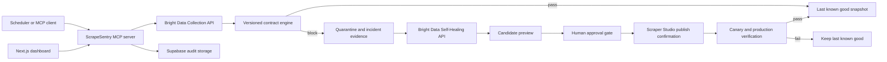

# ScrapeSentry

ScrapeSentry is an MCP server and operator dashboard that detects silent scraper drift, quarantines unsafe output and sends actionable failures to Bright Data Self-Healing. Every repair is held behind an approval gate then checked on canary and production output before recovery is declared.

Source: [github.com/himanshu748/scrapesentry](https://github.com/himanshu748/scrapesentry)

Live judge demo: [scrapesentry-himanshu748.onrender.com](https://scrapesentry-himanshu748.onrender.com)

CI: [latest ScrapeSentry CI run](https://github.com/himanshu748/scrapesentry/actions/workflows/ci.yml)

This repository contains a deterministic judge demo and a production adapter for Bright Data Scraper Studio.

The public demo is designed to be safe for judges: it replays a deterministic failure against captured production evidence, never consumes Bright Data credits and labels recorded provider evidence clearly. Live mode runs the same contract engine against the configured Scraper Studio collector.

## Why it exists

A scraper can return HTTP 200 while its data is unusable. Selectors drift, fields disappear, values change meaning and downstream systems keep consuming the result. ScrapeSentry treats scraper output as a versioned data product with explicit contracts.

## Judge demo

The included scenario is repeatable and does not depend on a live target website:

1. A captured Bright Data production snapshot passes contract v1 and becomes the last known good output.
2. **Simulate selector drift** changes `price` to `price_text` and `availability` to `stock_label`.
3. The health check detects structural drift and quarantines all 12 bad rows.
4. The protected downstream feed switches to fallback mode, keeps serving the 12 verified rows and exposes their age plus a quarantine warning.
5. **Generate repair** creates a deterministic candidate for the uninterrupted judge demo while the live-evidence panel shows the actual Bright Data Self-Healing job that produced a successful diff and preview.
6. **Approve repair** records the human decision. Schema changes require a second explicit override.
7. The provider evidence panel records the repair job, progress state, draft state and measured latency. The recorded demo is labeled clearly and does not pretend to be a live Self-Healing run.
8. **Run guarded verification** checks canary output then a fresh production snapshot.
9. ScrapeSentry marks the collector recovered only after both gates pass and releases the new verified snapshot to downstream consumers.

The judge scorecard makes the outcome visible without reading logs: **12 records protected**, **0 bad rows served** and **under one second to detect** in the deterministic demo. Verified recovery time is recorded from quarantine to the final production gate.

## Verified Bright Data production evidence

The deterministic demo is grounded in a real Scraper Studio production run against [Books to Scrape](https://books.toscrape.com/):

- collector `c_msxcshnz2bwrroekf3`
- latest API job `j_msyad7l21v1fnqbljn`
- 12 structured records across 13 pages
- 0 failed crawls and 100% success
- 12.3 second runtime and $0 spent
- 10-field output contract with absolute URLs, normalized availability and GBP prices
- Self-Healing job `ia_msya56gd1y2ucwwy0j`, completed with a successful diff and preview

The baseline raw provider output is committed as [`examples/brightdata-live-run.json`](examples/brightdata-live-run.json). The latest collection and Self-Healing metadata captured from the provider API and stats page is in [`examples/brightdata-day3-evidence.json`](examples/brightdata-day3-evidence.json). ScrapeSentry parses Bright Data JSON or NDJSON, normalizes Price objects at the adapter boundary then validates the exact fields shown in [`examples/contract.json`](examples/contract.json). The dashboard exposes both real job IDs, provider run statistics, Self-Healing progress, schema and an SHA-256 fingerprint of the baseline artifact.

The dashboard also renders the core MCP execution trace so judges can see how `check_health`, `get_drift_report`, `propose_heal`, `approve_heal`, `confirm_provider_publish` and `verify_recovery` advance through the safety gates. A ready-to-record walkthrough is available in [`outputs/ScrapeSentry-90-Second-Demo.md`](outputs/ScrapeSentry-90-Second-Demo.md).

A form-ready project narrative, verified metrics, limitations and AI disclosure are collected in [`outputs/ScrapeSentry-Submission-Draft.md`](outputs/ScrapeSentry-Submission-Draft.md).

The recovery flight recorder keeps the full judge story visible above the fold: live baseline, deliberate break, quarantine, Self-Healing, human approval then canary and production release. Every stage is derived from API state rather than a decorative animation.

## Architecture



The FastAPI and MCP interfaces call the same typed service layer, so browser actions and agent actions enforce identical safety rules.

## Included MCP tools

- `register_collector`
- `set_data_contract`
- `list_collectors`
- `check_health`
- `get_drift_report`
- `propose_heal`
- `get_heal_preview`
- `approve_heal`
- `confirm_provider_publish`
- `reject_heal`
- `verify_recovery`
- `rollback_heal`
- `get_run_history`
- `get_last_known_good`
- `run_monitor_cycle`

Commands that can repeat work require an idempotency key. Per-collector locks prevent overlapping local transitions. The Supabase schema adds unique idempotency constraints for durable deployments.

## Continuous monitoring

ScrapeSentry can check every registered collector on an interval without blocking the FastAPI event loop. Each cycle records completed checks, newly detected incidents, the last cycle time, the next scheduled cycle and any collector error. Repeated broken runs reuse the active incident and emit an `incident_reconfirmed` audit event instead of creating duplicate alerts.

Monitoring is disabled by default so a local startup cannot accidentally consume Bright Data credits. Enable it explicitly:

```dotenv
MONITOR_ENABLED=true
MONITOR_INTERVAL_SECONDS=60
```

Run a cycle through the API with `POST /api/monitor/run`, inspect it with `GET /api/monitor` or call the `run_monitor_cycle` MCP tool. The dashboard’s **Run monitor** control uses the same monitor path as the background scheduler.

## Run locally

Python 3.10+ and Node 20+ are supported.

```bash
python -m venv .venv
source .venv/bin/activate
pip install -e '.[dev]'
uvicorn app.api:app --reload --port 8000
```

In another terminal:

```bash
cd dashboard
npm install
npm run dev
```

Open [http://localhost:3000](http://localhost:3000). API docs are at [http://localhost:8000/docs](http://localhost:8000/docs).

Or start both services with Docker:

```bash
docker compose up --build
```

The API health check gates dashboard startup, so the judge demo does not open against an unready control plane.

## Deploy on Render

The included `render.yaml` creates two free web services in one Blueprint: a FastAPI control plane and a Next.js dashboard. Browser requests stay on the dashboard origin, then Next.js forwards API calls to the API service URL that Render injects from `RENDER_EXTERNAL_URL`.

1. Push this repository to GitHub.
2. In Render, create a new Blueprint from the repository.
3. Keep the default `main` branch and apply the Blueprint.
4. Open the `scrapesentry-himanshu748` service URL after both health checks pass.

The deployed judge experience is available at [scrapesentry-himanshu748.onrender.com](https://scrapesentry-himanshu748.onrender.com). Its full baseline, drift, quarantine, repair, approval, verification and release flow was exercised after deployment with no browser console errors. The API health endpoint is [scrapesentry-api-himanshu748.onrender.com/health](https://scrapesentry-api-himanshu748.onrender.com/health).

The public deployment intentionally uses `APP_ENV=demo`. Do not add a Bright Data token to the public judge service. Use the credential-safe GitHub workflow or a private production deployment for live scheduled checks.

Run the MCP server with:

```bash
python -m app.server
```

Example client configurations are available for Codex, Claude Code and Cursor in `.mcp/`.

## Test

```bash
python -m ruff check app tests
PYTHONPYCACHEPREFIX=/tmp/scrapesentry-pycache python -m pytest -q
cd dashboard && npm run lint && npm run build
```

Or run the complete local gate with `make verify`.

The tests cover healthy and broken contracts, cross-field semantics, last known good retention, idempotency, API errors, schema approval and the full recovery lifecycle.

The GitHub Actions workflow runs Ruff, pytest, TypeScript checks and the Next.js production build on every push and pull request.

The separate `Live Scraper Health` workflow triggers the real Scraper Studio Collector ID every day at 03:15 UTC, enforces the same production contract then uploads the provider job ID and result as a short-lived evidence artifact. Add `BRIGHTDATA_API_TOKEN` as a repository secret to activate it. The workflow never stores or prints the token.

## Use a live Bright Data collector

Copy `.env.example` to `.env` and set:

```dotenv
APP_ENV=production
BRIGHTDATA_API_TOKEN=...
BRIGHTDATA_COLLECTOR_ID=c_msxcshnz2bwrroekf3
```

The live adapter follows the documented Collection API flow:

- trigger with `POST /dca/trigger`
- poll output with `GET /dca/dataset`
- request a repair with `POST /dca/collectors/{collector_id}/refactor_template`
- poll repair progress with `GET /dca/collectors/{collector_id}/refactor_template/progress`

Run a credential-safe production smoke test with:

```bash
APP_ENV=production BRIGHTDATA_API_TOKEN=... python -m app.live_smoke
```

The command triggers the configured collector through Bright Data, parses JSON or NDJSON output, normalizes provider price objects and evaluates the real rows against the production contract. It prints job metadata and contract results without printing the token or dataset contents.

ScrapeSentry handles the real `pending_answer` state, records the provider job ID and accepts a human-approved diff through `resume_automation_job`. Bright Data’s `auto_save` option saved that approved template as production Version 2, so ScrapeSentry records the provider state as `published` then requires a fresh contract-valid production collection before declaring recovery. Manual provider workflows can still use `ready_for_review` plus `confirm_provider_publish`. The demo adapter makes activation deterministic for judging and labels its evidence as recorded. Live rollback intentionally stops with an explicit error because rollback belongs to the Bright Data Versions workflow and no public rollback endpoint is assumed.

## Supabase persistence

Apply `supabase/migrations/001_scrapesentry.sql` then set `SUPABASE_URL` and `SUPABASE_SERVICE_ROLE_KEY`. When both values are present, the runtime stores collectors, runs, repairs, last known good snapshots, idempotency records and audit events through PostgREST.

The service role key stays in the backend. Every ScrapeSentry table has row level security enabled and access is revoked from browser roles. Never expose this key through `NEXT_PUBLIC_*` variables.

## Coding-agent context

[`AGENTS.md`](AGENTS.md) pins the live Collector ID, public target, safe production command and verification command for coding agents. This prevents a new session from rebuilding the scraper or losing the production endpoint that downstream systems already use.

## Contract model

Contracts support:

- required fields and primitive types
- null thresholds and row-count bounds
- numeric ranges and allowed categories
- URL, email and datetime formats
- timestamp freshness
- row duplication and per-field uniqueness
- cross-field comparisons such as `price <= list_price`
- warning or blocking severity

Blocking violations quarantine the current snapshot. They never replace the last known good output.

Downstream services can call `GET /api/collectors/{collector_id}/safe-output`. When the latest run is quarantined, the endpoint returns the last known good rows with `stale: true`, their age and a warning.

## AI assistance disclosure

Codex was used to refine the product specification, implement the application, generate deterministic fixtures and run the test workflow. Product direction, scope decisions, Bright Data integration choices and final submission review remain the entrant's responsibility.

## Bright Data references

- [Scraper Studio API quickstart](https://docs.brightdata.com/datasets/scraper-studio/quickstart)
- [AI Flow overview](https://docs.brightdata.com/api-reference/scraper-studio-api/ai-flow/overview)
- [Trigger Self-Healing](https://docs.brightdata.com/api-reference/scraper-studio-api/ai-flow/trigger-self-healing)
- [Self-Healing job progress](https://docs.brightdata.com/api-reference/scraper-studio-api/ai-flow/self-healing-job-progress)
- [Self-Healing workflow](https://docs.brightdata.com/datasets/scraper-studio/self-healing-tool)
