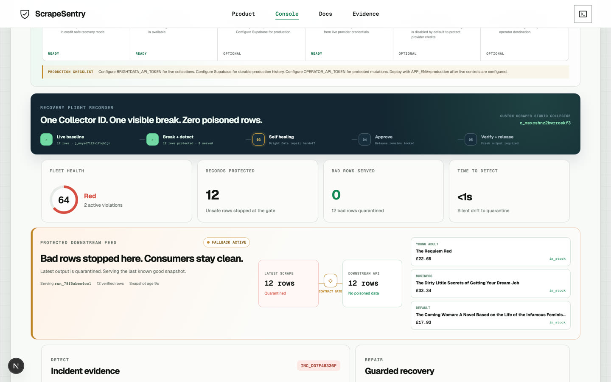
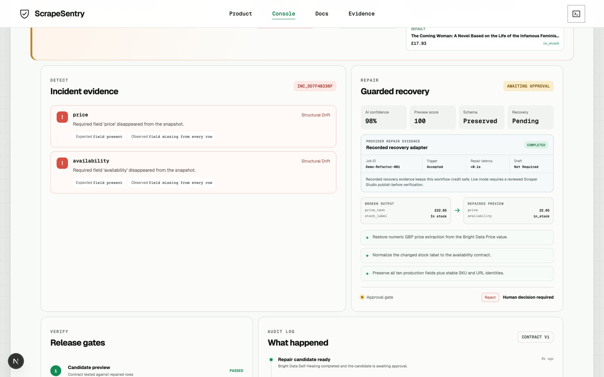
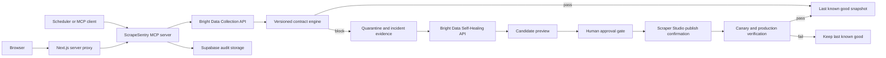

# ScrapeSentry

## Demo

**Watch the 2 minute 56 second walkthrough:** [YouTube](https://youtu.be/rvES9OQ8zQQ)

The same demo is also available on the [project site](https://scrapesentry.vercel.app/demo).

A compressed copy is committed at [`docs/demo/scrapesentry-demo.mp4`](docs/demo/scrapesentry-demo.mp4)
and the shot list it was built from is [`docs/demo-script.md`](docs/demo-script.md). It covers the
project, the tech stack and architecture, the live recovery demo and what the build taught me.

| | |
|---|---|
| YouTube demo | https://youtu.be/rvES9OQ8zQQ |
| Hosted demo video | https://scrapesentry.vercel.app/demo |
| Live dashboard (Render) | https://scrapesentry-himanshu748.onrender.com |
| Live dashboard (Vercel) | https://scrapesentry.vercel.app |
| API health | https://scrapesentry-api-himanshu748.onrender.com/health |
| Source | https://github.com/himanshu748/scrapesentry |

Both deployments run `APP_ENV=demo`: the workflow is recorded and credit safe, so nothing
you click spends Bright Data credits. The Render services are on the free tier and take
around 40 seconds to wake from cold.

### 60 seconds, four clicks

1. Open the [console](https://scrapesentry.vercel.app/console). Fleet score
   reads `100.0`, one real Bright Data collector, 12 protected records.
2. Click **Simulate selector drift**. Health falls to `64 Red`, 12 rows are quarantined
   and the protected downstream feed flips to **Fallback active** while still serving
   12 verified rows.
3. Click **Generate repair**, then **Approve repair**. Read the before/after diff:
   `price_text "£22.65"` becomes `price 22.65`, `stock_label "In stock"` becomes
   `availability "in_stock"`. Nothing reaches production without the human click.
4. Click **Run guarded verification**. Canary and production gates both pass, the incident
   closes and the feed returns to **Verified live**.




---

ScrapeSentry is an MCP server and operator dashboard that detects silent scraper drift, quarantines unsafe output and sends actionable failures to Bright Data Self-Healing. Every repair is held behind an approval gate then checked on canary and production output before recovery is declared.

Source: [github.com/himanshu748/scrapesentry](https://github.com/himanshu748/scrapesentry)

Live judge demo: [scrapesentry.vercel.app](https://scrapesentry.vercel.app/). The Render deployment remains available as a fallback at [scrapesentry-himanshu748.onrender.com](https://scrapesentry-himanshu748.onrender.com/).

CI: [latest ScrapeSentry CI run](https://github.com/himanshu748/scrapesentry/actions/workflows/ci.yml)

This repository contains a deterministic judge demo and a production adapter for Bright Data Scraper Studio.

The public demo is designed to be safe for judges: it replays a deterministic failure against captured production evidence, never consumes Bright Data credits and labels recorded provider evidence clearly. Live mode runs the same contract engine against the configured Scraper Studio collector.

## Submission evidence

| Requirement | Evidence |
|---|---|
| Public repository and setup | This README plus the [public GitHub repository](https://github.com/himanshu748/scrapesentry) |
| Example structured output | [`examples/brightdata-live-run.json`](examples/brightdata-live-run.json) and [`examples/contract.json`](examples/contract.json) |
| Custom Scraper Studio collector | Collector `c_msxcshnz2bwrroekf3`, production job `j_msyad7l21v1fnqbljn` and Self-Healing job `ia_msya56gd1y2ucwwy0j` |
| Public web data only | [Books to Scrape](https://books.toscrape.com/) is public, requires no login and contains no private, restricted, paywalled or government data |
| Demo video | [2 minute 56 second YouTube walkthrough](https://youtu.be/rvES9OQ8zQQ) covering the product, architecture, recovery workflow and learning |
| AI coding assistance | Disclosed in the [AI assistance section](#ai-assistance-disclosure) |

## Why it exists

A scraper can return HTTP 200 while its data is unusable. Selectors drift, fields disappear, values change meaning and downstream systems keep consuming the result. ScrapeSentry treats scraper output as a versioned data product with explicit contracts.

## Judge demo

The included scenarios are repeatable and do not depend on a live target website. Judges can run selector drift, quality collapse, semantic corruption or a partial crawl through the same policy engine. The complete recovery path is:

1. A captured Bright Data production snapshot passes contract v1 and becomes the last known good output.
2. **Simulate selector drift** changes `price` to `price_text` and `availability` to `stock_label`.
3. The health check detects structural drift and quarantines all 12 bad rows.
4. The protected downstream feed switches to fallback mode, keeps serving the 12 verified rows and exposes their age plus a quarantine warning.
5. **Generate repair** creates a deterministic candidate for the uninterrupted judge demo while the live-evidence panel shows the actual Bright Data Self-Healing job that produced a successful diff and preview.
6. **Approve repair** records the human decision. Schema changes require a second explicit override.
7. The provider evidence panel records the repair job, progress state, draft state and measured latency. The recorded demo is labeled clearly and does not pretend to be a live Self-Healing run.
8. **Run guarded verification** checks the candidate against the contract, then runs a second production collection through the same contract. In the recorded demo both gates read the repaired snapshot, so the run is deterministic; in live mode the canary and production collections are two separate Bright Data calls.
9. ScrapeSentry marks the collector recovered only after both gates pass and releases the new verified snapshot to downstream consumers.

The judge scorecard makes the outcome visible without reading logs: **12 records protected**, **0 bad rows served** and **under one second to detect** in the deterministic demo. A local run on 2026-08-22 measured 0.047 s from broken collection to quarantine and 0.068 s to clear both verification gates. The audit log timestamps every transition from `snapshot_quarantined` to `recovery_verified`, so the elapsed incident time is reconstructable from the timeline.

## Verified Bright Data production evidence

The deterministic demo is grounded in a real Scraper Studio production run against [Books to Scrape](https://books.toscrape.com/):

- collector `c_msxcshnz2bwrroekf3`
- latest API job `j_msyad7l21v1fnqbljn`
- 12 structured records across 13 pages
- 0 failed crawls and 100% success
- 12.3 second runtime and $0 spent
- 10-field output contract with absolute URLs, normalized availability and GBP prices
- Self-Healing job `ia_msya56gd1y2ucwwy0j`, completed with a successful diff and preview

The baseline raw provider output is committed as [`examples/brightdata-live-run.json`](examples/brightdata-live-run.json). The latest collection and Self-Healing metadata captured from the provider API and stats page is in [`examples/brightdata-day3-evidence.json`](examples/brightdata-day3-evidence.json). ScrapeSentry parses Bright Data JSON or NDJSON, normalizes Price objects at the adapter boundary then validates the exact fields shown in [`examples/contract.json`](examples/contract.json). The dashboard exposes both real job IDs, provider run statistics, Self-Healing progress, schema and an SHA-256 fingerprint of the baseline artifact.

The dashboard also renders the core MCP execution trace so judges can see how `check_health`, `get_drift_report`, `propose_heal`, `approve_heal`, `confirm_provider_publish` and `verify_recovery` advance through the safety gates. The [complete YouTube walkthrough](https://youtu.be/rvES9OQ8zQQ) shows this path end to end.

A form-ready project narrative, verified metrics, limitations and AI disclosure are collected in [`outputs/ScrapeSentry-Submission-Draft.md`](outputs/ScrapeSentry-Submission-Draft.md).

The recovery flight recorder keeps the full judge story visible above the fold: live baseline, deliberate break, quarantine, Self-Healing, human approval then canary and production release. Every stage is derived from API state rather than a decorative animation.

## Architecture



The FastAPI and MCP interfaces call the same typed service layer, so browser actions and agent actions enforce identical safety rules.

## Included MCP tools

- `register_collector`
- `set_data_contract`
- `list_collectors`
- `get_fleet_health`
- `get_alert_status`
- `get_system_readiness`
- `check_health`
- `get_drift_report`
- `propose_heal`
- `get_heal_preview`
- `approve_heal`
- `confirm_provider_publish`
- `reject_heal`
- `verify_recovery`
- `rollback_heal`
- `get_run_history`
- `get_last_known_good`
- `run_monitor_cycle`

Commands that can repeat work require an idempotency key. Per-collector locks prevent overlapping local transitions. The Supabase schema adds unique idempotency constraints for durable deployments.

## Continuous monitoring

ScrapeSentry can check every registered collector on an interval without blocking the FastAPI event loop. Each cycle records completed checks, newly detected incidents, the last cycle time, the next scheduled cycle and any collector error. Repeated broken runs reuse the active incident and emit an `incident_reconfirmed` audit event instead of creating duplicate alerts.

Monitoring is disabled by default so a local startup cannot accidentally consume Bright Data credits. Enable it explicitly:

```dotenv
MONITOR_ENABLED=true
MONITOR_INTERVAL_SECONDS=60
```

Run a cycle through the API with `POST /api/monitor/run`, inspect it with `GET /api/monitor` or call the `run_monitor_cycle` MCP tool. The dashboard’s **Run monitor** control uses the same monitor path as the background scheduler.

## Signed incident routing

ScrapeSentry can send HMAC-SHA256 signed webhooks when a new incident is quarantined and when guarded recovery is verified. Reconfirmed failures reuse the active incident and do not send duplicate notifications. Delivery failures are isolated from health checks and exposed through `GET /api/alerts` plus the `get_alert_status` MCP tool.

```dotenv
ALERT_WEBHOOK_URL=https://your-incident-router.example/scrapesentry
ALERT_WEBHOOK_SECRET=use-a-long-random-secret
```

Receivers verify `X-ScrapeSentry-Signature` against the exact request body prefixed by `X-ScrapeSentry-Timestamp` and a period. The public judge deployment leaves routing disabled because it has no operator-owned destination.

## Operator boundary and readiness

The browser talks only to the Next.js origin. A server-only route forwards API requests and adds `OPERATOR_API_TOKEN` for private production deployments, so the token never enters a browser bundle or a `NEXT_PUBLIC_*` variable. The FastAPI control plane fails closed when production mutations arrive without the matching bearer token.

State-changing routes share a sliding-window limit to protect provider credits. Every API response includes `X-Request-ID`, structured domain errors return the same ID and the dashboard shows it when an operation fails. Trusted host validation and response hardening (`X-Content-Type-Options`, `Referrer-Policy`, `Permissions-Policy`) are enabled at the FastAPI boundary. The Next.js layer sets its own `X-Frame-Options` and `Referrer-Policy`. Malformed request payloads return the same structured error envelope and request ID as domain errors.

`GET /api/readiness` and the `get_system_readiness` MCP tool report two separate outcomes:

- **Judge ready** means the deterministic credit-safe workflow is complete and grounded in recorded production evidence.
- **Production ready** requires live Bright Data credentials, Supabase persistence, an operator token and `APP_ENV=production`.

The dashboard renders every check and keeps missing production configuration visible. It never labels the public judge deployment as a fully configured private production system.

## Run locally

Python 3.10+ and Node 20+ are supported.

```bash
python -m venv .venv
source .venv/bin/activate
pip install -e '.[dev]'
uvicorn app.api:app --reload --port 8000
```

In another terminal:

```bash
cd dashboard
npm install
npm run dev
```

Open [http://localhost:3000](http://localhost:3000). API docs are at [http://localhost:8000/docs](http://localhost:8000/docs).

Or start both services with Docker:

```bash
docker compose up --build
```

The API health check gates dashboard startup, so the judge demo does not open against an unready control plane.

## Deploy on Vercel and Render

The public architecture uses Vercel for the Next.js product and Render for the FastAPI control plane. Browser requests stay on the Vercel origin. The server-only Next.js proxy forwards API calls to `API_SERVER_URL`, so provider and operator credentials never enter browser code.

1. Deploy the repository's `dashboard` directory to Vercel.
2. Keep the included Render Blueprint connected to `main` for the FastAPI service.
3. Set `API_SERVER_URL=https://scrapesentry-api-himanshu748.onrender.com` in Vercel when using a different API deployment.
4. Set `NEXT_PUBLIC_SITE_URL` to the final Vercel production URL for stable canonical metadata.
5. Verify `/`, `/console`, `/docs` and `/evidence`, then complete one recovery cycle in `/console`.

The server proxy includes a safe production fallback to the public judge API, so Vercel previews remain functional before environment variables are configured. The API health endpoint is [scrapesentry-api-himanshu748.onrender.com/health](https://scrapesentry-api-himanshu748.onrender.com/health).

The public deployment intentionally uses `APP_ENV=demo`. Do not add a Bright Data token to the public judge service. Use the credential-safe GitHub workflow or a private production deployment for live scheduled checks.

Run the MCP server locally with:

```bash
python -m app.server
```

Example client configurations are available for Codex, Claude Code and Cursor in `.mcp/`.

The MCP transport is intentionally not exposed as an unauthenticated public Render service. A protected remote transport can be deployed later without changing the shared policy engine.

## Test

```bash
python -m ruff check app tests
PYTHONPYCACHEPREFIX=/tmp/scrapesentry-pycache python -m pytest -q
cd dashboard && npm run lint && npm run build
```

Or run the complete local gate with `make verify`.

The tests cover healthy output, four unrelated failure classes, cross-field semantics, last known good retention, idempotency, API errors, schema approval, mutation authentication, rate limiting, readiness reporting and the full recovery lifecycle.

The GitHub Actions workflow runs Ruff, pytest, TypeScript checks and the Next.js production build on every push and pull request.

The separate `Live Scraper Health` workflow triggers the real Scraper Studio Collector ID every day at 03:15 UTC, enforces the same production contract then uploads the provider job ID and result as a short-lived evidence artifact. Add `BRIGHTDATA_API_TOKEN` as a repository secret to activate it. The workflow never stores or prints the token.

## Use a live Bright Data collector

Copy `.env.example` to `.env` and set:

```dotenv
APP_ENV=production
BRIGHTDATA_API_TOKEN=...
BRIGHTDATA_COLLECTOR_ID=c_msxcshnz2bwrroekf3
OPERATOR_API_TOKEN=use-a-long-random-server-only-value
ALLOWED_HOSTS=localhost,127.0.0.1,your-api.example.com
```

Configure the same `OPERATOR_API_TOKEN` on the private Next.js dashboard service. Do not expose it through a `NEXT_PUBLIC_*` variable. Add Supabase credentials before relying on audit history across restarts.

The live adapter follows the documented Collection API flow:

- trigger with `POST /dca/trigger`
- poll output with `GET /dca/dataset`
- request a repair with `POST /dca/collectors/{collector_id}/refactor_template`
- poll repair progress with `GET /dca/collectors/{collector_id}/refactor_template/progress`

Run a credential-safe production smoke test with:

```bash
APP_ENV=production BRIGHTDATA_API_TOKEN=... python -m app.live_smoke
```

The command triggers the configured collector through Bright Data, parses JSON or NDJSON output, normalizes provider price objects and evaluates the real rows against the production contract. It prints job metadata and contract results without printing the token or dataset contents.

ScrapeSentry handles the real `pending_answer` state, records the provider job ID and accepts a human-approved diff through `resume_automation_job`. Bright Data’s `auto_save` option saved that approved template as production Version 2, so ScrapeSentry records the provider state as `published` then requires a fresh contract-valid production collection before declaring recovery. Manual provider workflows can still use `ready_for_review` plus `confirm_provider_publish`. The demo adapter makes activation deterministic for judging and labels its evidence as recorded. Live rollback intentionally stops with an explicit error because rollback belongs to the Bright Data Versions workflow and no public rollback endpoint is assumed.

## Supabase persistence

Apply `supabase/migrations/001_scrapesentry.sql` then set `SUPABASE_URL` and `SUPABASE_SERVICE_ROLE_KEY`. When both values are present, the runtime stores collectors, runs, repairs, last known good snapshots, idempotency records and audit events through PostgREST.

The service role key stays in the backend. Every ScrapeSentry table has row level security enabled and access is revoked from browser roles. Never expose this key through `NEXT_PUBLIC_*` variables.

## Coding-agent context

[`AGENTS.md`](AGENTS.md) pins the live Collector ID, public target, safe production command and verification command for coding agents. This prevents a new session from rebuilding the scraper or losing the production endpoint that downstream systems already use.

## Contract model

Contracts support:

- required fields and primitive types
- null thresholds and row-count bounds
- numeric ranges and allowed categories
- URL, email and datetime formats
- timestamp freshness
- row duplication and per-field uniqueness
- cross-field comparisons such as `price <= list_price`
- warning or blocking severity

Blocking violations quarantine the current snapshot. They never replace the last known good output.

Downstream services can call `GET /api/collectors/{collector_id}/safe-output`. When the latest run is quarantined, the endpoint returns the last known good rows with `stale: true`, their age and a warning.

## AI assistance disclosure

Codex was used to refine the product specification, implement the application, generate deterministic fixtures and run the test workflow. The entrant reviewed the implementation, ran the full verification suite and can explain the architecture, provider adapter, contract engine and recovery state machine. Product direction, scope decisions, Bright Data integration choices and final submission review remain the entrant's responsibility.

## Bright Data references

- [Scraper Studio API quickstart](https://docs.brightdata.com/datasets/scraper-studio/quickstart)
- [AI Flow overview](https://docs.brightdata.com/api-reference/scraper-studio-api/ai-flow/overview)
- [Trigger Self-Healing](https://docs.brightdata.com/api-reference/scraper-studio-api/ai-flow/trigger-self-healing)
- [Self-Healing job progress](https://docs.brightdata.com/api-reference/scraper-studio-api/ai-flow/self-healing-job-progress)
- [Self-Healing workflow](https://docs.brightdata.com/datasets/scraper-studio/self-healing-tool)
